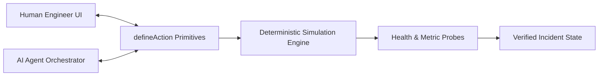

# ⚡ TraceBack AI — Agent-Native Incident Investigation & Recovery Workspace

> **Built for the Builder.io Agent-Native Hackathon 2026**  
> *Autonomous AI agent and human engineers operating as equal peers on shared actions, telemetry data, and deterministic recovery state.*

[](https://www.typescriptlang.org/)
[](https://nextjs.org/)
[](https://github.com/BuilderIO/agent-native)
[](./docs/TEST_REPORT.md)

---

## 1. Problem Statement

When production outages occur at 2 AM, software engineering teams are inundated with thousands of raw log lines, fluctuating metric dashboards, and ambiguous git deployments.

Generic AI chatbots fail in this domain because:
- **Opaque Chat Bubbles:** They merely summarize text in a side panel without access to executable application actions.
- **Unverified Hallucinations:** They claim an issue is "fixed" without inspecting actual system telemetry.
- **Unsafe Mutations:** They lack structured human authorization gates, making autonomous action too risky for production infrastructure.

---

## 2. Solution: TraceBack AI

**TraceBack AI** implements Builder.io's **Agent-Native** paradigm:
- **Shared Primitives:** The human engineer and the AI agent share the exact same tools and action definitions (`defineAction`).
- **Evidence-Grounded Reasoning:** Every hypothesis cites immutable evidence (log timestamps, commit hashes, metric threshold spikes).
- **Human-in-the-Loop Safety:** Destructive actions (rollbacks, flag toggles, restarts) require explicit human review and authorization.
- **Deterministic Verification:** The application deterministically verifies system state after recovery execution; the agent cannot declare an incident resolved without passing active health probes.

---

## 3. Core Product Features

- **3 Deterministic Production Outage Scenarios:**
  1. *Checkout Outage (`inc-8921`):* NullPointerException introduced in release `v2.4.1` spiking HTTP 500 error rates to 42.8%.
  2. *Session CrashLoop (`inc-4402`):* Unbounded in-memory token cache causing JVM heap exhaustion (`OOMKilled`).
  3. *DB Connection Exhaustion (`inc-7119`):* Leaked connection pool clients in unreleased async cohort queries.
- **Agent-Native Actions (`defineAction`):**
  - `getServiceLogs`: Filter simulated logs by service, level, and timeframe.
  - `inspectDeploymentDiff`: Retrieve git commit diffs, authors, and modified lines.
  - `getTelemetryMetrics`: Fetch timeseries CPU, memory, error rates, and p99 latency.
  - `checkServiceHealth`: Deterministic health probes.
  - `rollbackDeployment`: Safe rollback to last known stable release.
  - `toggleFeatureFlag`: Live operational flag disabling.
  - `restartService`: Rolling pod restart.
- **Human Approval Card:** Clear blast-radius indicators (`LOW`, `MEDIUM`, `HIGH`) and one-click authorization.
- **Audit Trail & Post-Mortem Generator:** Generates exportable Markdown incident post-mortems with MTTR calculation.
- **100% Mobile Responsive:** Optimized for both mobile devices (on-call phones) and desktop command centers.

---

## 4. Agent-Native Architecture



---

## 5. Quick Start & Local Setup

### Prerequisites
- Node.js v18+ or v20+

### Setup Commands
```bash
# Clone repository
git clone https://github.com/251fa04c84-boop/cultureweave-ai.git traceback-ai
cd traceback-ai

# Install dependencies
npm install

# Run automated test suite (39/39 passing)
npm test

# Launch local development server
npm run dev
```

Open [http://localhost:3000](http://localhost:3000) to view the workspace.

---

## 6. Project Documentation Suite

- [Official Hackathon Requirements & Audit](./docs/HACKATHON_REQUIREMENTS.md)
- [System Architecture & Technical Specification](./docs/PROJECT_ARCHITECTURE.md)
- [Team Work Plan & Allocation](./docs/TEAM_WORK_PLAN.md)
- [Team Collaboration & Contributing Guide](./docs/CONTRIBUTING.md)
- [Submission Day Checklist](./docs/SUBMISSION_CHECKLIST.md)
- [2-Minute Demo Script & Video Narration](./docs/DEMO_SCRIPT.md)
- [Automated Test & Verification Report](./docs/TEST_REPORT.md)

---

## 7. Compliance & Safety

- **Zero Client Secrets:** No API keys are bundled or exposed to the client.
- **Offline Benchmark Mode:** Resilient dual-mode execution ensures 100% judge uptime without external API dependencies.
- **Strict Authorization:** All mutating actions strictly enforce `userApprovalGranted: true`.
