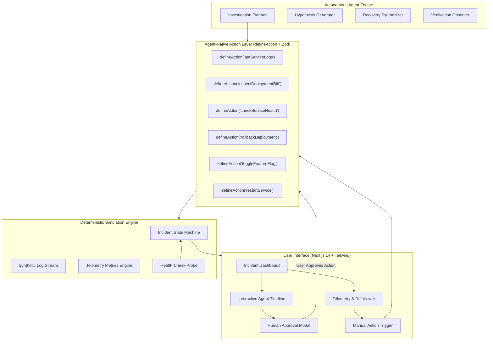

# TraceBack AI — Project Architecture & Technical Specification

**Version:** 1.0.0  
**Status:** Approved for Implementation  
**Framework:** Builder.io Agent-Native Architecture (`@agent-native/core`)  

---

## 1. Executive Summary

**TraceBack AI** is an **Agent-Native Incident Investigation and Recovery Workspace**. It transforms how software engineering teams triage, debug, and recover from production outages.

Instead of treating AI as an isolated side-panel chatbot that merely summarizes text, TraceBack AI implements Builder.io's **Agent-Native** paradigm:
- **Shared Primitives:** The human engineer and the AI agent share the exact same tools, action definitions (`defineAction`), and application state.
- **Evidence-Grounded Reasoning:** Every hypothesis cites immutable evidence (log timestamps, commit hashes, metric threshold spikes).
- **Human-in-the-Loop Safety:** Destructive actions (rollbacks, flag toggles, restarts) require explicit human review and authorization.
- **Deterministic Verification:** The application deterministically verifies system state after recovery execution; the agent cannot declare an incident resolved without passing health probes.

---

## 2. High-Level Architecture Diagram



---

## 3. The Agent-Native Core Pattern (`defineAction`)

All application capabilities are defined once in `lib/actions/` using the Agent-Native pattern:

```typescript
import { z } from "zod";

export interface ActionDefinition<TInput, TOutput> {
  id: string;
  name: string;
  description: string;
  isMutating: boolean;
  requiresApproval: boolean;
  schema: z.ZodType<TInput>;
  run: (input: TInput, context: ActionContext) => Promise<TOutput>;
}
```

### Dual-Invocation Symmetry
1. **Human Click:** When an engineer clicks "Execute Rollback" in the UI, the frontend dispatches `rollbackDeployment.run({ releaseId: 'v2.4.0' })`.
2. **Agent Autonomous Dispatch:** When the AI agent determines that release `v2.4.1` introduced a fatal regression, it dispatches the same `rollbackDeployment.run({ releaseId: 'v2.4.0' })`.
3. **Approval Interception:** If `requiresApproval: true`, the runtime halts execution, displays the proposed action and blast-radius to the human, and waits for a signed user approval before mutating system state.

---

## 4. Deterministic Simulation Engine & Scenarios

To ensure judge-ready reliability without requiring access to unstable external infrastructure, TraceBack AI ships with three high-fidelity simulated production incidents:

### Scenario 1: The Null Pointer Poison Pill (Checkout Outage)
* **Service:** `checkout-service`
* **Trigger:** Release `v2.4.1` deployed 12 minutes ago by `@dev-alex`.
* **Telemetry:** HTTP 500 error rate spikes to 42.8%; latency p99 hits 3,450ms.
* **Evidence:** `NullPointerException at PaymentGatewayController.java:142` when `coupon_code` is null.
* **Recovery Action:** Rollback deployment to `v2.4.0`.
* **Verification:** Error rate drops to <0.02%, health checks return 200 OK.

### Scenario 2: Memory Leak Cascade (Session Service OOMKilled)
* **Service:** `session-auth-service`
* **Trigger:** Cache eviction bug in Redis session cluster adapter.
* **Telemetry:** JVM heap ramp from 45% to 99%; Pod status: `OOMKilled` (restart count: 6).
* **Evidence:** `java.lang.OutOfMemoryError: Java heap space` in pod logs.
* **Recovery Action:** Restart session pods & enable fallback in-memory bounded cache flag `DISABLE_UNBOUNDED_CACHE`.
* **Verification:** Heap stabilizes at 48%, restarts cease, health checks green.

### Scenario 3: Connection Pool Exhaustion (Analytics Query Release)
* **Service:** `postgres-analytics-service`
* **Trigger:** Feature flag `FF_ASYNC_ANALYTICS_V2` enabled without connection pool timeout.
* **Telemetry:** Active DB connections 100/100; HTTP 504 Gateway Timeout on user queries.
* **Evidence:** `FATAL: remaining connection slots are reserved for non-replication superuser connections`.
* **Recovery Action:** Disable feature flag `FF_ASYNC_ANALYTICS_V2` & cycle connection pool.
* **Verification:** Active connections drop to 18/100, latency normalizes to 45ms.

---

## 5. Security and Data Integrity Safeguards

1. **Deterministic Verification Gate:** An incident cannot transition to `RESOLVED` purely through LLM text generation. The system requires:
   - System error rate `< 1.0%`
   - Active health check HTTP 200 OK
   - 0 crashing pods in simulated cluster
2. **Zero Client Secrets:** Model execution and action processing occur server-side (`app/api/agent/route.ts` and `app/api/actions/route.ts`).
3. **Resilient Dual-Mode Execution:**
   - **Mode A (Live AI):** Calls Gemini / Anthropic API when an API key is provided.
   - **Mode B (Deterministic Benchmark Mode):** Uses pre-calibrated reasoning trees for uninterrupted judging even when external keys or networks are offline.

---

## 6. Directory Structure

```text
traceback-ai/
├── app/
│   ├── api/
│   │   ├── actions/          # Agent-native action dispatch endpoint
│   │   ├── agent/            # Agent reasoning & orchestration endpoint
│   │   ├── incidents/        # Incident state & simulation endpoint
│   │   └── health/           # Health probe verification endpoint
│   ├── layout.tsx            # Global layout & styling
│   └── page.tsx              # Main incident response workspace
├── lib/
│   ├── actions/              # defineAction definitions (Agent-Native core)
│   │   ├── index.ts          # Action registry
│   │   ├── logs.ts           # getServiceLogs
│   │   ├── metrics.ts        # getTelemetryMetrics
│   │   ├── deployment.ts     # inspectDeploymentDiff & rollbackDeployment
│   │   ├── health.ts         # checkServiceHealth
│   │   └── flags.ts          # toggleFeatureFlag
│   ├── agent/                # Multi-step agent orchestrator
│   │   ├── engine.ts         # Agent reasoning loop
│   │   ├── prompts.ts        # System prompts & schema definitions
│   │   └── types.ts          # Timeline and hypothesis types
│   ├── simulator/            # Deterministic simulation state machine
│   │   ├── scenarios.ts      # 3 production scenarios & telemetry
│   │   └── engine.ts         # State transitions & health probes
│   └── utils/                # Formatters, styling helpers
├── docs/                     # Full hackathon documentation suite
└── scripts/                  # Automated verification & test suites
```

---

## 7. Compliance with Hackathon Guidelines

- **Agent-Native Framework:** Implements symmetrical `defineAction` with Zod validation.
- **Judge-Ready:** Zero setup required; instant 1-click incident selection and investigation.
- **Mobile Responsive:** Works seamlessly on mobile devices as required by team constraints.
